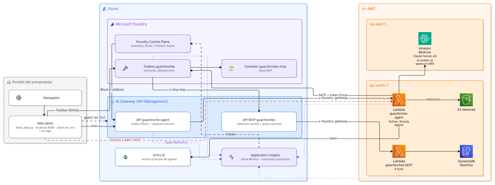
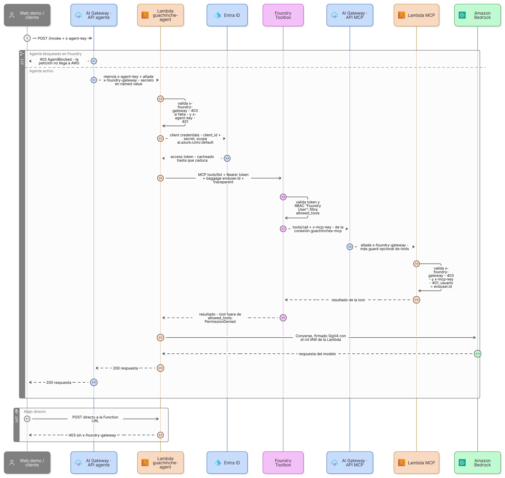

# AWS agent governed from Microsoft Foundry: ¿dónde comemos? 🍷

Last demo of the session *¿Quién controla a tus agentes? Hosted Agents y AI Gateway en Foundry*: an agent
running in AWS that finds **guachinches in Tenerife** for lunch, with its tools served by an **MCP
server** that also runs in AWS. Both are registered behind the Foundry **AI Gateway**, and the agent gets its tools only from a Foundry
**Toolbox**, so from Foundry you can see them, trace them, block the agent, and block individual tools, all
without touching AWS.

> **Session:** *¿Quién controla a tus agentes? Hosted Agents y AI Gateway en Foundry*, The Azure Tour Tenerife,
> 7 November 2026, by David Lorenzo and Jorge Fernández. This repo is **demo 2** (AI Gateway); demo 1 (Hosted
> Agent) is Jorge's. [Slides (Spanish)](https://claude.ai/artifact/WW4vUkwJJSU2dsVssA71Do).



```
client ─► AI Gateway /guachinche-agent ─► Lambda: guachinche-agent (Strands) ─► Bedrock (Claude, stays in AWS)
          (Foundry: Block / Unblock)                   │ Entra token, no MCP key
                                                       ▼
                                Foundry Toolbox "guachinches" (default version = the tools the agent gets)
                                                       │ project connection (holds the MCP key)
                                                       ▼
                                AI Gateway MCP API (+ x-foundry-gateway, optional tool guard)
                                                       ▼
                                Lambda: guachinche-agent-mcp ──► DynamoDB (favourites)
                                search_guachinches · get_guachinche · list_locations · add/remove/list_favorite(s)

   App Insights ◄── OTel spans from gateway, agent and MCP server ──► Foundry Control Plane (traces, runs, errors)
```

| Piece | Where |
|---|---|
| Agent: Strands Agents + Bedrock; its tools come from MCP | [aws/agent/guachinche_agent.py](aws/agent/guachinche_agent.py) |
| Agent HTTP API (`GET /health`, `POST /invoke`) and origin checks | [aws/agent/app.py](aws/agent/app.py) |
| MCP server (MCP Python SDK v2, streamable HTTP, stateless) | [aws/mcp/server.py](aws/mcp/server.py) |
| Guachinche catalogue + search by town/zone/region, dishes, features, wine, day, price | [aws/mcp/guachinches.py](aws/mcp/guachinches.py) |
| Favourites per user (DynamoDB) | [aws/mcp/favorites.py](aws/mcp/favorites.py) |
| Conversation memory per user + session (Strands S3SessionManager, 7-day expiry) | [aws/agent/guachinche_agent.py](aws/agent/guachinche_agent.py) |
| AWS infra: 2 Lambdas + Function URLs, DynamoDB, S3 sessions bucket, Bedrock IAM (SAM) | [aws/template.yaml](aws/template.yaml) |
| Azure infra: Foundry resource + project + App Insights (Bicep) | [azure/main.bicep](azure/main.bicep) |
| Scripts: deploy, calls, origin lock, tool blocking | [scripts/](scripts/) |
| Foundry Toolbox: versions of the tool catalogue, the agent's Entra identity to use it, and the MCP key that only Foundry holds | [scripts/toolbox.sh](scripts/toolbox.sh), [scripts/toolbox-identity.sh](scripts/toolbox-identity.sh), [scripts/rotate-mcp-key.sh](scripts/rotate-mcp-key.sh) |
| Demo web (local): chat, per-call trace, tool switches at the gateway | [web/index.html](web/index.html), [scripts/demo_web.py](scripts/demo_web.py) |
| Setup and live demo script | [docs/demo-runbook.md](docs/demo-runbook.md) |

> The guachinches are **real places**, from a Google Places snapshot built by
> [scripts/fetch_guachinches.py](scripts/fetch_guachinches.py) into `aws/mcp/data/guachinches.json`:
> search in each of the 31 municipalities, Place Details for guachinche-like names, then
> [classification](aws/mcp/classify.py) (guachinche or not; town → zone → region from locality, postal code
> and position; features from Google attributes; dishes and wines from reviews). Google's terms restrict
> storing and redistributing Places content, so **the snapshot isn't in this repo**: build your own (needs a
> Google Maps Platform key with Places API (New)) and treat it as private demo data.
>
> Without it, the MCP server uses **invented sample data** that ships with the repo:
> [aws/mcp/data/guachinches.sample.json](aws/mcp/data/guachinches.sample.json), 40 fictional guachinches in real
> towns, generated by [scripts/make_sample_data.py](scripts/make_sample_data.py). Everything works the same, and
> the tools tell the agent the places are made up.
>
> ```bash
> GOOGLE_MAPS_API_KEY=... python3 scripts/fetch_guachinches.py        # refresh (uses data/raw/ cache)
> python3 scripts/fetch_guachinches.py --classify-only                 # re-run classification only, free
> ```

## Authentication, end to end



- **Client → AI Gateway → agent:** the client sends `x-agent-key`; Foundry's Block policy can answer 403
  `AgentBlocked` before AWS; the gateway adds the secret `x-foundry-gateway` that the Lambda requires.
- **Agent → Foundry Toolbox:** an Entra token (client credentials, scope `https://ai.azure.com/.default`) for a
  service principal with "Foundry User" on the project. The user travels in W3C `baggage` (`enduser.id`).
- **Toolbox → AI Gateway → MCP:** the Toolbox adds `x-mcp-key` from its project connection, the gateway adds
  `x-foundry-gateway`, and the MCP Lambda checks both. The agent never holds the MCP key.
- **Agent → Bedrock:** SigV4 with the Lambda's IAM role, inside AWS.

## What Foundry controls, and what it doesn't

| | Foundry can | Foundry can't |
|---|---|---|
| **Agent** | List it, trace it, **Block** it at the gateway (403 `AgentBlocked`) | Stop the Lambda, or touch Bedrock: the agent keeps running in AWS, it just can't take requests |
| **MCP tools** | Publish them in a **Toolbox**, the agent's only source of tools: its default version decides which tools the agent gets (a tool left out is hidden and rejected). Optionally also block calls at the gateway | Change the tool code, or see inside it without telemetry |
| **Model calls** | — (the agent calls Bedrock inside AWS) | Govern or meter them. For that, the model would also have to go through the gateway |

The **origin lock** is what makes this real: without it, anyone with the Lambda URLs could skip the gateway.
`scripts/lock-origin.sh` makes the gateway add a secret header that both Lambdas require.

## Why these choices

- **A different stack on purpose (Python + Strands + Bedrock)**: the session's own agent is .NET on Foundry.
  The point is that Control Plane doesn't care what an agent is built with or where it runs.
- **Tools as an MCP server, not in-process functions**: Foundry can only govern what crosses the
  gateway. Functions inside the agent show up in traces but can't be blocked.
- **Stateless MCP on Lambda**: no sessions to keep, so each request is independent and Lambda-friendly.
  The handler builds a fresh MCP HTTP app per invocation because the SDK's session manager starts only once.
- **Tool blocking via a named value**: `scripts/block-tool.sh add_favorite` changes one APIM named value
  that a policy reads, so blocking or unblocking takes a second and needs no redeploy. It answers like Agent
  365's tool-level block (`isError: true`), so the agent explains instead of retrying.
- **Traces straight to App Insights**: the agent and MCP server export OTel GenAI spans with the Azure Monitor
  exporter, and the agent continues APIM's W3C trace, so gateway + agent show up as one transaction.

## Prerequisites

- Azure: a Foundry (new) resource + project with an **AI Gateway** and **Application Insights**
  ([azure/main.bicep](azure/main.bicep) creates all but the gateway, which you add in the portal).
- AWS account with Bedrock access *and quota* for the model in the chosen region (new accounts start at 0,
  see the runbook).
- CLIs: `az`, `aws`, `sam`, `python3`, `openssl`.

Start with [docs/demo-runbook.md](docs/demo-runbook.md).
